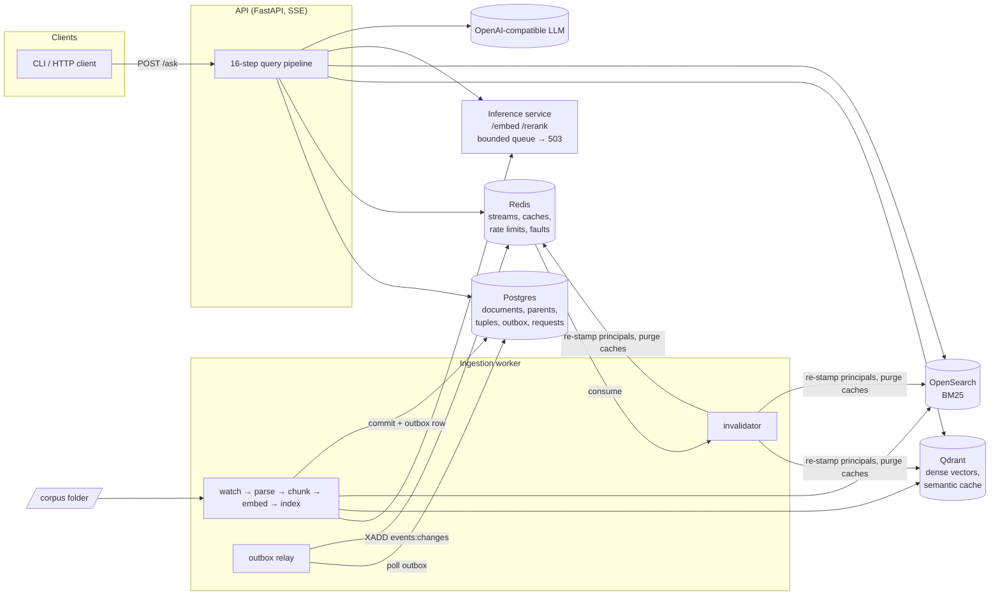

# permission-aware-rag

A retrieval-augmented generation (RAG) service built from scratch, without LangChain, LlamaIndex or any other RAG framework. It answers questions over a folder of documents with streamed, cited answers. Every user sees only the documents they are allowed to read, and stale or revoked content is never served, even from cache.

The focus is system design rather than model size. Small open models (`bge-small-en-v1.5`, a MiniLM cross-encoder) and any OpenAI-compatible LLM sit behind a pipeline built around correctness under change: permissions that update live, versioned indexing that readers never see half-done, transactional change events, and a defined degraded mode for every dependency.

## Highlights

- **Hybrid retrieval:** dense vectors (Qdrant) and BM25 (OpenSearch) run in parallel, are fused with Reciprocal Rank Fusion, reranked by a cross-encoder, and expanded from small child chunks to their parent sections.
- **Relationship-based permissions** (Zanzibar-style tuples): users, nested groups, folders and documents. Readers are stamped on every chunk and filtered inside both indexes, then rechecked against the live tuples before generation. Default deny.
- **Filtered-search planning:** a user who can read few chunks gets an exact scan instead of HNSW, so recall doesn't collapse under very selective permission filters.
- **Three cache tiers:**
  - an exact answer cache
  - a semantic answer cache, guarded by matching entities and negations and a 0.98 similarity threshold
  - a parent-chunk cache

  Every cache hit is revalidated against live document versions and permissions. Concurrent identical misses run the pipeline once.
- **Zero-downtime re-indexing:** each document version is written to the indexes, committed in Postgres, and only then are the old chunks removed. A reader sees either the old version or the new one, never a mix.
- **Transactional outbox:** change events are written in the same database transaction as the change and relayed to Redis Streams at least once. Cache invalidation and permission re-stamping consume them idempotently.
- **Separate inference service** for the embedder and reranker, with bounded concurrency and a bounded queue. When it is full it rejects requests at once, and the API answers without reranking instead of slowing down.
- **Graceful degradation:**
  - one retrieval branch down: answer from the other
  - reranker down: keep the fused order
  - LLM down: extractive answer built from the retrieved passages

  Faults can be injected at runtime to test this.
- **Guardrails:** input checks for prompt injection, personal data and length; the output guard removes invalid citations and redacts personal data that isn't in the context. Retrieved text is always treated as data, never as instructions.
- **Measured:** latency per stage on every request, plus an evaluation harness for recall@10, MRR and LLM-judged faithfulness.

## Architecture



Each store does one job:

| Store | Role |
| --- | --- |
| Postgres | Source of truth: documents and versions, parent chunks, permission tuples, outbox, sessions, request logs, feedback, evaluation runs |
| Qdrant | Dense child-chunk vectors with a `principals` payload filter, plus the semantic answer cache |
| OpenSearch | BM25 keyword search over the same chunks, with the same `principals` filter |
| Redis | Ingestion and change-event streams, answer and chunk caches, rate-limit counters, fault flags |

## How a question is answered

`POST /ask` runs these steps in `rag/api/pipeline.py`, recording the duration of each:

1. **Authenticate:** hash the API key, look up the user, apply the per-minute rate limit.
2. **Expand principals:** the user plus every group reachable through nested `member` tuples, hashed into a permission fingerprint.
3. **Input guard:** reject questions that are too long, look like prompt injection, or contain personal data.
4. **Rewrite:** turn a follow-up into a standalone question using recent session turns (small LLM).
5. **Exact cache:** look up `sha256(normalized question | fingerprint | index version)`.
6. **Embed** the question, through the inference service or in-process.
7. **Semantic cache:** take the nearest cached question for the same fingerprint. It counts as a hit only if similarity is at least 0.98 and entities and negations match.
8. **Retrieve:** dense and BM25 in parallel, both filtered by principals, each with a timeout. Dense search picks an exact scan or HNSW from a count of readable chunks.
9. **RRF fusion.**
10. **Recheck:** drop candidates whose document was deleted, changed version, or is no longer readable under the live tuples.
11. **Rerank** with the cross-encoder, under a timeout.
12. **Hydrate:** map child chunks to parent sections, served from the chunk cache with Postgres as the fallback.
13. **Assemble:** abstain if nothing relevant is left. Otherwise fit the token budget and order the context best-at-both-ends to counter lost-in-the-middle.
14. **Generate:** stream from the LLM. If it fails, fall back to an extractive answer.
15. **Output guard:** release one sentence at a time, drop invalid `[n]` citations, redact personal data that isn't in the context.
16. **Persist:** store the turn and the request log, then write the caches if the answer is clean, meaning not degraded, not an abstention, and cited.

Cache hits at step 5 or 7 skip straight to step 16, but only after the cached answer's document versions and readability have been revalidated.

## How a document is indexed

The worker watches `corpus/` (Markdown, text and PDF). For each changed file it:

1. Skips the file if its content hash is unchanged.
2. Parses it into sections, keeping code blocks and tables whole. PDFs are parsed with docling.
3. Chunks it into parent sections and sentence-aligned child chunks. Optionally, an LLM writes one or two sentences of context per parent (contextual chunking).
4. Stamps each chunk with its document's readers from the permission tuples.
5. Indexes the new version into Qdrant and OpenSearch.
6. Commits in one Postgres transaction: the new parents, the document version and an outbox event.
7. Cleans up the older version's chunks.

Until step 6 commits, the recheck gate hides the new chunks, and after it the old ones. Failed jobs are retried by a reclaim loop and sent to a dead-letter stream after repeated failures.

The outbox relay publishes committed events to `events:changes`. The invalidator purges the cached answers and chunks of changed documents. When a `viewer` or `parent` tuple changes, it re-stamps the affected chunks' principals in both indexes.

## Permission model

Access comes from tuples `(subject, relation, object)`:

| Relation | Meaning |
| --- | --- |
| `user:x member group:y` | membership; groups nest |
| `group:y viewer folder:z` | may read the folder and everything beneath it (also on single documents) |
| `doc:d parent folder:z` | maintained automatically from file paths |

Membership changes take effect on the user's next request, because their principal expansion changes. Viewer changes take effect immediately through the live recheck, and the indexes are re-stamped shortly after. A chunk with no readers matches nobody.

## Quick start

Requirements: Docker, [uv](https://docs.astral.sh/uv/), GNU make. On Windows, run `winget install ezwinports.make` and use Git Bash.

```bash
cp .env.example .env        # add LLM_BASE_URL, LLM_API_KEY, LLM_MODEL, LLM_SMALL_MODEL for real answers
uv sync
make up                     # Postgres, Redis, Qdrant, OpenSearch
make migrate                # schema, collections, indexes
make seed                   # fixture users, groups and API keys
cp -r tests/fixtures/corpus/* corpus/   # optional sample documents
```

Run the worker and the API in two terminals:

```bash
make worker
```

```bash
make api                    # http://127.0.0.1:8000
```

Ask a question:

```bash
uv run python -m rag.api.client "How many paid leave days do we get?" --key dev-ben
```

Optional: run the models as a separate service (port 8100) and set `INFERENCE_URL=http://127.0.0.1:8100` in `.env`:

```bash
make inference
```

Optional: run the API, worker and inference service in containers:

```bash
docker compose --profile app up -d
```

The seed creates development users `ana` (engineering), `ben` (HR), `cal` (no groups) and `admin`, with API keys `dev-ana`, `dev-ben`, `dev-cal` and `dev-admin`.

## API

All endpoints take an `X-API-Key` header, except `/healthz`.

| Endpoint | Purpose |
| --- | --- |
| `POST /ask` | `{"session_id", "question"}` → Server-Sent Events: `token`, `citations`, `warning`, `done` (`cache_tier`, `degraded`, `abstained`), `error` |
| `POST /feedback` | `{"request_id", "rating": 1 \| -1, "comment"}` |
| `POST /admin/tuples` | Add or remove a permission tuple (admin) |
| `POST /admin/faults` | Set `dense`, `sparse`, `reranker` or `llm` to `ok`, `slow` or `down` (admin) |
| `GET /healthz` | Health of every dependency, including the inference service when used |

Example `done` event for an answer whose reranker timed out:

```json
{"request_id": "…", "cache_tier": "none", "degraded": ["rerank"], "abstained": false}
```

## Failure behaviour

| Failure | Result |
| --- | --- |
| Dense or BM25 down or slow | Answer from the other branch; `degraded` names the failed branch |
| Both retrieval branches down | `error: retrieval_unavailable` |
| Reranker down, slow, or inference service full | Fused order is kept; `degraded: rerank` |
| Query embedding refused or failed | `error: embedding_unavailable` |
| LLM down or slow | Extractive answer from the top passages; `degraded: llm` |
| Redis down during a permission change | Event waits in the Postgres outbox and is published on recovery |

Degraded answers are never cached.

## Configuration

Every setting is optional and has a default in `rag/common/config.py`. The ones you are most likely to change:

| Setting | Default | Purpose |
| --- | --- | --- |
| `MODEL_BACKEND` | `real` | `real` or `fake` (deterministic test models) |
| `LLM_BASE_URL`, `LLM_API_KEY`, `LLM_MODEL`, `LLM_SMALL_MODEL` | none | OpenAI-compatible chat completions endpoint |
| `INFERENCE_URL` | none | Use the separate inference service instead of in-process models |
| `INFERENCE_CONCURRENCY`, `INFERENCE_QUEUE_MAX` | 2, 8 | Inference backpressure limits |
| `RETRIEVE_TIMEOUT_MS`, `RERANK_TIMEOUT_MS` | 500, 2000 | Per-stage timeouts |
| `SEMANTIC_CACHE_THRESHOLD` | 0.98 | Minimum similarity for a semantic cache hit |
| `EXACT_SCAN_MAX_CHUNKS` | 2000 | Use an exact scan at or below this many readable chunks |
| `CONTEXTUAL_CHUNKING` | false | LLM-written context per parent chunk |
| `QDRANT_QUANTIZATION` | none | `none`, `int8` or `binary` |
| `INDEX_VERSION` | v1 | Change it to rebuild the indexes after model or chunking changes |
| `RATE_LIMIT_PER_MIN` | 60 | Requests per API key per minute |

See `.env.example` for the full list.

## Testing and evaluation

Tests use deterministic fake models, so they need no GPU and no LLM key.

```bash
make test               # unit tests
```

```bash
make test-int           # integration tests against the real stores (run make up first)
```

```bash
make test-int-context   # integration tests with contextual chunking on
```

```bash
make test-int-remote    # integration tests through the inference service
```

```bash
make lint               # ruff check and format
```

```bash
make eval               # recall@10, MRR, faithfulness and per-stage latency on rag/evals/golden.jsonl
```

The integration suite covers:

- default deny and per-user visibility
- live revocation, including of cached answers
- versioned re-indexing and deletes
- cache invalidation and the stale-answer races
- outbox delivery across a Redis outage
- filtered-search planning
- every degraded mode
- inference backpressure
- dead-letter handling, rate limits, sessions and PDFs

`make eval` stores each run's configuration and metrics in the `eval_runs` table, so changes can be compared over time.

## Project layout

```
rag/
├── common/      config, store clients, ids, cache keys, permissions, models, faults, text utils
├── api/         FastAPI app, auth, guards, rewrite, cache, retrieve, rerank, hydrate, generate, pipeline
├── worker/      watcher, parser, chunker, contextualizer, indexer, outbox relay, invalidator
├── inference/   embed and rerank service with backpressure
└── evals/       golden set and scorer
migrations/      Postgres schema
prompts/         answer, rewrite, context and judge prompts
tests/           unit and integration suites, fixture corpus
```

## Documentation

- `SPEC.md`: the full design, covering data model, permission queries, the query and ingestion paths, API contract and fault model.
- `DECISIONS.md`: the choices that still matter, and open questions.
- `AGENTS.md`: the working rules the project was built under.

## Limitations

- Single node: no sharding, replication or multi-tenancy.
- Request coalescing works within one API process only.
- Development API keys come from the seed. There is no user sign-up.
- The bundled golden set is small and runs over the fixture corpus. Real quality numbers need your own documents and questions.
